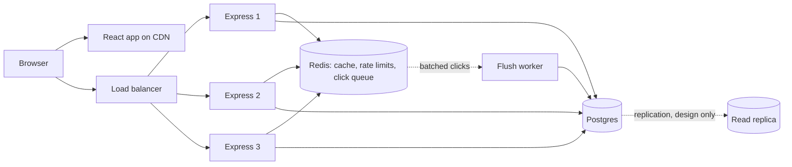

# Snip: URL Shortener

A full-stack URL shortener (like Bitly or TinyURL) built to learn real-world system design. Shorten links, set custom aliases and expiry dates, and see click analytics. Includes caching, rate limiting, batched analytics, Docker, and a load-balanced setup.

**Live demo:** https://url-shortener-delta-ruby.vercel.app/
**API:** https://simple-shortener-api.onrender.com

> The backend runs on a free tier, so the first request after a quiet period can take about a minute to wake up.


## Features

- Shorten any public `http`/`https` URL, **no account needed**
- Accounts with secure login (bcrypt + JWT in HTTP-only cookies)
- Dashboard: search, filter (active/expired), pagination, copy, delete
- Custom aliases (like `/my-portfolio`) and expiration dates
- Analytics per link: clicks per day, referrers, browsers, OS, devices, recent clicks
- Fast redirects with a Redis cache
- Abuse protection: rate limits, URL safety checks, input validation
- Light and dark mode

## Tech stack (and why)

| Tool | Why it is here |
|---|---|
| React, Vite, TypeScript, Tailwind CSS | Fast, typed, easy-to-style frontend |
| Express 5, TypeScript | Simple REST API |
| PostgreSQL + Prisma | Relational data, unique constraints, SQL analytics, migrations |
| Redis (ioredis) | Link cache, rate limits, click queue |
| Docker, Docker Compose, nginx | Same setup everywhere, plus a load balancer demo |
| zod | One place for input validation |
| pino, prom-client | Structured logs and Prometheus metrics |
| Neon, Render, Vercel, Redis Cloud | Free hosting for the database, API, frontend, Redis |

## Architecture



**How a click works**

1. `GET /abc1234` hits any server (they are stateless).
2. The server looks the code up in **Redis**. On a miss it reads **Postgres** and saves the answer in Redis (with a TTL).
3. It replies with a **302** redirect.
4. The click is pushed to a **Redis queue**. A worker saves up to 1000 clicks at a time in one SQL statement.

## Key design decisions

| Decision | Reason |
|---|---|
| Random 7-character Base62 codes + retry | 3.5 trillion options, unguessable, no coordination. The unique index decides. |
| 302 redirect (not 301) | Every click can be counted, and links can be deleted or expire. 301 is cached forever by browsers. |
| Redis cache-aside, TTL, cache warming, negative caching | Fast redirects, less database load, and no broken new links |
| Cache and rate limiter fail open | If Redis is down the app slows down but keeps working |
| Click queue + batch insert | Avoids one write per click and the "hot row" problem on viral links |
| Snowflake-style IDs for clicks | Servers create IDs without asking the database. Retries are safe. |
| HTTP-only cookies for JWT | JavaScript (and XSS) can't read the token |
| `/health` and `/ready` | A broken dependency makes the app "degraded", not "down" |

More notes on scaling (load balancing, replicas, sharding, CDN, CAP) are in the `server/src/idgen` demos and the design notes below.

## Run locally

Requirements: Node 20+, Docker Desktop.

```bash
git clone https://github.com/<MrRashid01>/url-shortener.git
cd url-shortener

# 1. Start Postgres and Redis
cp .env.example .env            # put a long random JWT_SECRET inside
docker compose up -d postgres redis

# 2. Backend
cd server
cp .env.example .env            # see the table below
npm install
npx prisma migrate dev
npm run dev                     # http://localhost:5000

# 3. Frontend (new terminal)
cd client
echo "VITE_API_URL=http://localhost:5000" > .env
npm install
npm run dev                     # http://localhost:5173
```

Create a secret quickly:

```bash
node -e "console.log(require('crypto').randomBytes(48).toString('hex'))"
```

### Everything in Docker

Stop the dev servers first, then:

```bash
docker compose up -d --build
```

Open http://localhost:8080 (API on port 5000).

### Load balancer demo (3 servers behind nginx)

```bash
docker compose down
docker compose -f docker-compose.lb.yml up -d --build --scale server=3
```

Open http://localhost:8080. The API is behind nginx on port 8000. Check how requests spread out:

```bash
for i in $(seq 1 30); do curl -si http://localhost:8000/health | grep -i '^x-upstream'; done | sort | uniq -c
```

## Environment variables (server)

| Variable | Description |
|---|---|
| `DATABASE_URL` | Postgres connection string |
| `REDIS_URL` | Redis connection string |
| `JWT_SECRET` | At least 32 random characters |
| `BASE_URL` | Public URL of the API (used in short links) |
| `CLIENT_URL` | Frontend origin(s) for CORS, comma-separated, no trailing slash |
| `PORT` | Server port (default 5000) |
| `NODE_ENV` | `development` or `production` |
| `CROSS_SITE_COOKIES` | `true` only when frontend and API are on different sites |
| `REDIRECT_STATUS` | `301`, `302` (default), `307` or `308` |
| `REDIRECT_BROWSER_CACHE_SECONDS` / `REDIRECT_CDN_CACHE_SECONDS` | Cache time for redirects (default 0) |
| `METRICS_TOKEN` | Optional token to protect `/metrics` |
| `CACHE_ENABLED` / `CLICK_BUFFER` | Set to `false` to turn off the Redis cache or click batching (for benchmarks) |

Frontend: `VITE_API_URL` (API address, set at **build** time).

## API

| Method | Path | Notes |
|---|---|---|
| `POST` | `/api/auth/register`, `/api/auth/login`, `/api/auth/logout` | Sets or clears the auth cookie |
| `GET` | `/api/auth/me` | Current user |
| `POST` | `/api/urls` | Create a link. Aliases and expiry need login for aliases. |
| `GET` | `/api/urls?search=&status=&page=` | Your links |
| `DELETE` | `/api/urls/:id` | Delete one of your links |
| `GET` | `/api/urls/:id/stats?days=30` | Analytics for one of your links |
| `GET` | `/:code` | Redirect (404 if missing, 410 if expired) |
| `GET` | `/health`, `/ready`, `/metrics` | Probes and Prometheus metrics |

## Project structure

```
url-shortener/
├── client/                React + Vite + Tailwind
│   └── src/               pages/, components/, api.ts, AuthContext.tsx
├── server/
│   ├── prisma/            schema and migrations
│   └── src/
│       ├── routes/        auth and url routes
│       ├── middleware/    auth, rate limiting
│       ├── lib/           prisma, redis, url cache, click queue, logger, metrics
│       ├── jobs/          expired link cleanup
│       ├── idgen/         Base62, Snowflake, shard demo, tests
│       └── utils/         validation, analytics helpers
├── docker-compose.yml
├── docker-compose.lb.yml  3 servers + nginx
└── nginx-lb.conf
```

## Tests

```bash
cd server
npx tsx --test src/idgen/idgen.test.ts
```

Experiments (Base62, Snowflake IDs, collisions, consistent hashing):

```bash
npx tsx src/idgen/demo.ts
npx tsx src/idgen/shardDemo.ts
```

## Deployment

Frontend on Vercel, API (Docker) on Render, Postgres on Neon, Redis on Redis Cloud. The container runs `prisma migrate deploy` on start. When the frontend and API are on different domains, set `CROSS_SITE_COOKIES=true`. Using one custom domain for both (like `app.example.com` and `api.example.com`) is better.

## Scaling notes (design, how this would grow)

- **Servers:** stateless, so add more behind a load balancer.
- **Reads:** Redis first, then read replicas.
- **Writes and size:** partition the click table by month, move analytics to a column database, shard by hash of the code (using consistent hashing) only when needed.
- **Clicks:** queue and batch writes (built here). Kafka or Redis Streams for stronger delivery guarantees.
- **CDN:** static files today. Edge caching of redirects trades analytics accuracy for speed.
- **CAP:** redirects favor availability. Alias creation favors consistency.

## Known limits

- Free-tier hosting means cold starts.
- A JWT can't be revoked before it expires (7 days). A refresh-token or token blocklist would fix it.
- Clicks can be lost if the server crashes in the short moment between taking them from the queue and saving them.
- Replicas, sharding and edge caching are designed, not built.
- URL safety checks block private and internal addresses but do not check for phishing sites (Google Safe Browsing would be the next step).

## Future work

- Rate limit 404s on redirects, Safe Browsing check
- Daily rollup tables and click partitions
- API tests (supertest) and a read replica

## Author

**Rashid Khan**: [GitHub](https://github.com/<MrRashid01>) 
